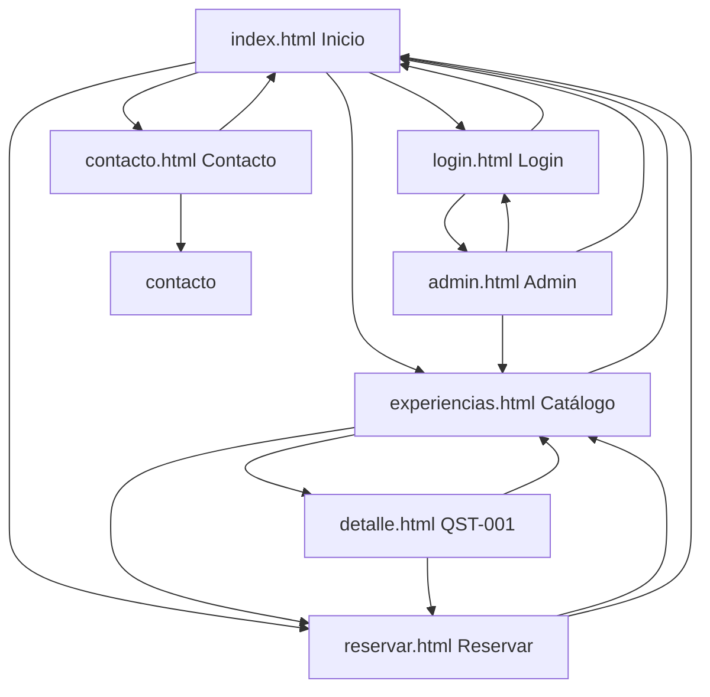

# Mapa del sitio — QuestPass CR

## Páginas obligatorias (7)

1. `index.html` — Inicio
2. `experiencias.html` — Catálogo
3. `detalle.html` — Ficha de experiencia (QST-001 en Avance 1)
4. `reservar.html` — Formulario de reserva
5. `contacto.html` — Formulario de contacto
6. `login.html` — Acceso administrativo (maqueta)
7. `admin.html` — Panel administrativo (maqueta)

## Diagrama de navegación

## Relaciones principales

| Desde | Hacia | Motivo |
|-------|-------|--------|
| Todas | `index.html` | Logo «QuestPass CR» y enlace «Inicio» |
| `index.html` | `experiencias.html`, `reservar.html`, `contacto.html` | Flujo del visitante |
| `experiencias.html` | `detalle.html` | Ver ficha de QST-001 |
| `experiencias.html` | `reservar.html` | Reservar desde catálogo |
| `detalle.html` | `reservar.html` | CTA de reserva |
| `login.html` | `admin.html` | Enlace de maqueta «Ir al panel» (sin autenticación real) |
| `admin.html` | `login.html` | Cerrar sesión (enlace estático) |
